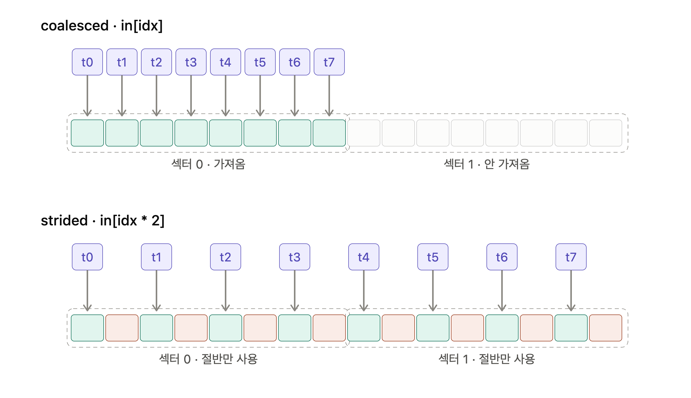

# Coalesced memory access

## 핵심

GPU는 바이트 단위로 읽지 않는다. **32 B 섹터 단위**로 읽는다. 따라서 중요한 건 "필요한 바이트가 몇 개냐"가 아니라 "워프가 건드리는 섹터가 몇 개냐"다.

```
워프 = 32 스레드
섹터 = 32 B = float 8개
캐시라인 = 128 B = 섹터 4개
32 스레드 × float 4 B = 128 B = 캐시라인 1개  ← 이상적 상태
```

숫자가 맞물리도록 하드웨어가 설계돼 있다.

## 손실 규모

한 섹터에 float 8개가 들어 있는데 stride 2로 읽으면 4개만 쓰고 버린다. 데이터 양은 같은데 트래픽만 늘어난다.

| 패턴                  | sectors/request | 효율        |
| ------------------- | --------------- | --------- |
| Coalesced           | 4               | 100 %     |
| Stride 2            | 8               | 50 %      |
| Stride 4            | 16              | 25 %      |
| Stride ≥ 8 / random | 최대 32           | 12.5 % 이하 |

## 진단

Nsight Compute **Memory Workload Analysis**에서 `sectors per request`를 본다. 4.0이면 완벽, 넘으면 안 쓸 바이트를 긁어오는 중이다. Load Efficiency 하락과 DRAM throughput 저조가 함께 나타난다.

## 기법



**1. 인덱싱** — `threadIdx.x`가 1 늘 때 주소도 원소 하나만 늘어야 한다.

```cpp
out[row * W + col]   // col이 threadIdx.x 기반 → OK
out[col * H + row]   // → H칸씩 점프, 망함
```

**2. AoS → SoA** — stride가 자료구조에서 생기는 경우

```cpp
struct Particle { float x, y, z; };   // x만 써도 y·z가 끌려옴, 33 %
struct Particles { float x[N], y[N], z[N]; };  // 연속
```

**3. Shared memory 경유** — transpose처럼 읽기·쓰기 중 하나는 반드시 strided일 때. HBM 양쪽을 coalesced로 만들고 치환은 on-chip에서 한다. 뱅크 충돌 방지로 `tile[32][33]` 패딩

4.128B 정렬 — `cudaMalloc`은 안전하지만 포인터 오프셋이 깬다. 2D는 `cudaMallocPitch`.

**5. 벡터 로드** — stride를 못 없애면 `float4`로 트랜잭션 수를 압축


## 2. Vectorized Memory Access

## 핵심

Coalescing은 **섹터 낭비**를 고치고, vectorization은 **명령어 수**를 줄인다. 축이 다르니 둘 다 적용한다.

- Coalescing: 런타임 하드웨어 최적화, 스레드 _사이_
- Vectorization: 컴파일 타임 전략, 스레드 _내부_

## 왜 필요한가

scalar float 로드는 coalesced여도 32개 스레드가 **32번의 명령어**를 내고, 하드웨어가 꿰매서 128B를 만든다. `float4`를 쓰면 스레드당 로드가 1개로 줄어 **명령어 수 1/4**이 된다.

```
scalar : 32 × 4 B  = 128 B  → 128B 트랜잭션 1개
float4 : 32 × 16 B = 512 B  → 128B 트랜잭션 4개
float8 : 32 × 32 B = 1024 B → 128B 트랜잭션 8개
```

sectors per request는 계속 4.0이다. 
요청이 커진 만큼 트랜잭션 수가 비례해 늘 뿐, 128 B당 4섹터 구조는 안 바뀐다.

## 세대별 벡터 폭

| 세대                  | 스레드당            | 정렬 요구 |
| ------------------- | --------------- | ----- |
| ~Hopper             | 16 B (`float4`) | 16 B  |
| Blackwell + CUDA 13 | 32 B            | 32 B  |

8-float 내장 타입이 없어 직접 정의한다.

```cpp
struct alignas(32) float8 { float v[8]; };
```

`alignas(32)`를 빼면 16 B 로드 2개로 쪼개져 이득이 사라진다.

## 정렬이 전제조건

- `cudaMalloc`은 최소 256 B 정렬 보장 → 할당 자체는 안전
- 깨지는 곳은 **오프셋**. 원소 오프셋이 벡터 폭의 배수가 아니면 무너진다
- `reinterpret_cast`는 **단언일 뿐 검사하지 않는다**
- `N`이 4(또는 8)로 안 나눠떨어지면 나머지는 scalar로 따로 처리

## 결과 (Table 7-2)

| 지표              | scalar | vectorized |
| --------------- | ------ | ---------- |
| Load Efficiency | 28 %   | 97 %       |
| sectors/request | 31.8   | 4.0        |
| DRAM throughput | 25 %   | 90 %       |
| 커널 시간           | 4.2 ms | 1.2 ms     |

단 before의 31.8은 **scalar라서가 아니라 정렬·연속성까지 깨져 있었다**는 뜻이다. 제대로 coalesced된 scalar라면 4.0이 나온다. 3.5배는 coalescing 교정 + 벡터화의 합산 효과다.

## 적용 순서

**coalescing 교정 → 정렬 보장 → 벡터화**. 순서가 바뀌면 효과가 안 난다.
